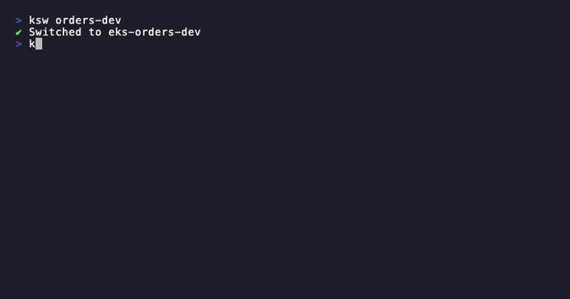

# ksw

**AI-powered** Kubernetes context switcher for your terminal. Built in Go.

🌐 **[yoniergomez.github.io/ksw](https://yoniergomez.github.io/ksw/)**

[](https://github.com/YonierGomez/ksw/releases/latest)
[](LICENSE)
[](go.mod)
[](https://github.com/YonierGomez/ksw/releases/latest)
[](https://github.com/YonierGomez/ksw/releases/latest)
[](https://github.com/YonierGomez/ksw/stargazers)

Switch contexts with natural language, manage groups, pins and aliases. Browse hundreds of clusters in 11 switchable views (environment-aware, with profile and account), sync AWS SSO profiles and EKS clusters to kubeconfig automatically and clean up retired accounts. Single binary, no runtime dependencies.

> Available for **macOS** and **Linux** (amd64 & arm64).

### Interactive TUI


### AI — Natural Language


---

## Features

### Free

- **Fuzzy search** — type any part of a context name to filter instantly (it also matches profile and environment)
- **11 cluster views** (`Ctrl+V`) — plain list, kubectx-style, columns with env tabs, grouped, foldable tree, by region, apps × environments matrix, one card per app, multi-column grid, split with detail panel. Your choice is remembered — see [Cluster views](#cluster-views)
- **Environment & profile aware** — `-dev` / `-qa` / `-pdn` / `-prod` / `-sbx` / `-lab` detected from the name (production in red) and the AWS profile of the account shown for the selected cluster
- **Short / full names** — `Ctrl+H` toggles `eks-payments-dev` ↔ full ARN in every view
- **Short-name switching** — `ksw payments-dev` instead of the full ARN
- **Aliases** — `ksw @prod` gets you there instantly
- **Pins** — pin favorites to always appear at the top (`Ctrl+P` in TUI)
- **Groups** — organize contexts and open TUI filtered to a group
- **Previous context** — `ksw -` toggles back like `cd -` in bash
- **History** — `ksw history` shows last 10 contexts, `ksw history 3` jumps to any
- **AI natural language** — switch, create, list, rename — just describe what you want
- **EKS kubeconfig sync** — discover and add EKS clusters to kubeconfig in parallel
- **EKS TUI** (`ksw eks config`) — interactive manager for kubeconfig: sync, view clusters, remove stale
- **K8s resource explorer** (`ksw k8s`) — interactive TUI to browse pods, deployments, services, nodes and more with per-cell semantic coloring, horizontal scroll, multi-select delete, label-based logs and live metrics
- **AWS SSO config TUI** (`ksw aws sso config`) — create, edit, delete SSO sessions, login, sync profiles and kubeconfig — all from an interactive TUI
- **AWS SSO login** (`ksw aws sso login`) — login to any configured SSO session
- **Profile sync** (`ksw aws sso profiles sync`) — auto-scan SSO accounts and sync all profiles to `~/.aws/config` with live progress and a **report of every new account added** (profile, account ID, SSO name)
- **Retired-account cleanup** — accounts that no longer exist in AWS SSO are detected after a sync, and you can remove their profile **and** their clusters from the kubeconfig (selection + confirmation, with a backup of `~/.aws/config`)
- **Reliable sync** — exact-ARN cluster matching, SSO token selection/refresh, retries on transient AWS CLI errors and deterministic profile renames
- **Profile management** (`ksw aws sso profiles list/add/search`) — list, add and search AWS profiles
- **Shell completion** — zsh and bash

---

## Install

### One-line installer (macOS & Linux — easiest)

```bash
curl -sL https://raw.githubusercontent.com/YonierGomez/ksw/main/install.sh | bash
```

### Homebrew (macOS & Linux)

```bash
brew tap YonierGomez/ksw
brew trust yoniergomez/ksw   # Homebrew 6+ requires trusting third-party taps
brew install ksw
```

### Manual — Linux

```bash
# amd64 (x86_64)
curl -sL https://github.com/YonierGomez/ksw/releases/latest/download/ksw-linux-amd64.tar.gz | tar xz
chmod +x ksw-linux-amd64
sudo mv ksw-linux-amd64 /usr/local/bin/ksw

# arm64 (AWS Graviton, Raspberry Pi, etc.)
curl -sL https://github.com/YonierGomez/ksw/releases/latest/download/ksw-linux-arm64.tar.gz | tar xz
chmod +x ksw-linux-arm64
sudo mv ksw-linux-arm64 /usr/local/bin/ksw
```

### Manual — macOS

```bash
# Apple Silicon (M1/M2/M3/M4)
curl -sL https://github.com/YonierGomez/ksw/releases/latest/download/ksw-darwin-arm64.tar.gz | tar xz
chmod +x ksw-darwin-arm64
sudo mv ksw-darwin-arm64 /usr/local/bin/ksw

# Intel
curl -sL https://github.com/YonierGomez/ksw/releases/latest/download/ksw-darwin-amd64.tar.gz | tar xz
chmod +x ksw-darwin-amd64
sudo mv ksw-darwin-amd64 /usr/local/bin/ksw
```

### From source

```bash
go install github.com/YonierGomez/ksw@latest
```

---

## Usage

```bash
# ── Context ──
ksw                              # Interactive TUI (fuzzy search)
ksw <name>                       # Switch directly (short name ok)
ksw -                            # Switch to previous context
ksw rename <old> <new>           # Rename a context in kubeconfig
ksw -l                           # List contexts (non-interactive)

# ── AI ──
ksw ai "<query>"                 # Natural language: switch, create, list, delete...
ksw ai chat                      # Interactive conversational mode (multi-turn)
ksw ai config                    # Configure AI provider (openai, claude, gemini, bedrock)

# ── AI + K8s Diagnostics ──
ksw ai "qué pods están fallando en argocd?"
ksw ai "muéstrame los logs del deployment argocd-server"
ksw ai "hay eventos de error en kube-system?"
ksw ai "qué pods consumen más CPU?"

# ── Aliases ──
ksw @<alias>                     # Switch using alias
ksw alias <name> <context>       # Create alias
ksw alias rm <name>              # Remove alias
ksw alias ls                     # List aliases

# ── Pins ──
ksw pin <name>                   # Pin context to top of list
ksw pin rm <name>                # Unpin
ksw pin ls                       # List pins
ksw pin use                      # TUI filtered to pinned only

# ── Groups ──
ksw group add <name> [ctx...]    # Create group (glob ok: "eks-pay*")
ksw group rm <name>              # Remove group
ksw group ls                     # List groups
ksw group use <name>             # TUI filtered to group
ksw group add-ctx <g> <ctx>      # Add context to group
ksw group rmi <g> <ctx>          # Remove context from group

# ── History ──
ksw history                      # Show recent context history
ksw history <n>                  # Switch to history entry by number

# ── EKS ──
ksw eks config                   # Interactive EKS / kubeconfig manager (TUI)
ksw eks kubeconfig sync          # Sync EKS clusters → ~/.kube/config
ksw eks kubeconfig sync --profile <n>  # Sync only one AWS profile

# ── K8s Resource Explorer ──
ksw k8s                          # Interactive pod explorer (default: pods)
ksw k8s pods                     # Browse pods with live CPU/MEM metrics
ksw k8s deployments              # Browse deployments (^l for aggregated logs)
ksw k8s services                 # Browse services
ksw k8s nodes                    # Browse nodes
ksw k8s -n <namespace>           # Start in a specific namespace

# ── AWS SSO ──
ksw aws sso config               # Interactive SSO session manager (TUI)
ksw aws sso login                # Login to default SSO session
ksw aws sso login <session>      # Login to a specific SSO session
ksw aws sso profiles list        # List configured AWS profiles
ksw aws sso profiles sync        # Auto-sync SSO accounts to ~/.aws/config
ksw aws sso profiles add <n> <id>  # Add a single profile
ksw aws sso profiles search <t>  # Search profiles by name or account ID

# ── License ──
ksw license activate             # Activate interactively (key hidden)
ksw license activate <key>       # Activate with key as argument
ksw license deactivate           # Remove license (frees slot to move to another machine)
ksw license buy                  # Open checkout in browser
ksw license status               # Show license status

# ── Shell Completion ──
ksw completion install           # Auto-install in ~/.zshrc or ~/.bashrc
ksw completion zsh               # Print zsh setup line
ksw completion bash              # Print bash setup line

# ── Other ──
ksw -h, --help                   # Help
ksw -v, --version                # Version
```

### Interactive TUI Navigation

| Key          | Action                              |
|--------------|-------------------------------------|
| Type         | Fuzzy filter in real time           |
| `↑` / `↓`   | Move up / down                      |
| `Home`/`End` or `Ctrl+A`/`Ctrl+E` | Go to top / bottom (Ctrl works on keyboards without Home/End) |
| `PgUp/PgDn`  | Jump 10 items                       |
| `Backspace`  | Delete filter character             |
| `Enter`      | Switch to highlighted context       |
| `Ctrl+P`     | Pin / unpin current context (★)     |
| `Ctrl+T`     | Jump to first pinned context        |
| `Ctrl+F`     | Toggle pinned-only filter           |
| `Ctrl+H`     | Toggle short / full names (works in every view, persisted) |
| `←` / `→` / `Tab` | Switch tab (All · dev · qa · pdn · prod · sbx · lab · ★ pins · ⏱ recent) in table views |
| `Space`      | Fold / unfold group (tree, region) |
| `Ctrl+V`     | Open the view picker (persisted)    |
| `Esc`        | Clear filter / Quit                 |
| `Ctrl+C`     | Quit                                |

### Cluster views

`ksw` starts with the plain list. Press `Ctrl+V` to open the **view picker** (↑↓ + Enter, or `Ctrl+V` again for the next one); your choice is remembered in `~/.ksw.json` (`view_mode`). Terminals narrower than 90 columns always use the plain list (`kubectx` works at any width).

| View | What it shows |
|------|---------------|
| `list` (default) | The original flat list, with the AWS profile of the selected cluster next to `current` |
| `kubectx` | fzf-style like [kubectx](https://github.com/ahmetb/kubectx): full-screen list of names, best match at the bottom next to the prompt. The row under the cursor is bright blue on a soft band, the rest is dimmed and the current context is green. `↑` goes up the screen |
| `simple` | A plain list like the original, plus environment and profile on every row |
| `columns` | Table: cluster · environment · profile (· region when you have several), with tabs: All · dev · qa · pdn · prod · sbx · lab · ★ pins · ⏱ recent |
| `grouped` | Same table grouped by application (all the environments of an app together), with a header per group |
| `tree` | Foldable tree by application — `Space` folds, `Enter` on a folded group unfolds it |
| `region` | Foldable tree by AWS region |
| `matrix` | Applications × environments grid (`●` per cluster) — move with `←↑↓→` |
| `cards` | One card per application with all its environments together (`dev` / `qa` / `pdn`…); missing ones show as `none`. `↑↓` move, `←→` jump between cards |
| `grid` | Cluster names in several columns, `ls` style — `←→` change column, `Tab` switches tab |
| `split` | List on the left, detail panel on the right (needs ≥ 110 columns) |

```
# cards
╭─ payments ──────────────────── ● ● ● ╮
│ ❯ DEV  eks-payments-dev   pay-dev    │
│   QA   eks-payments-qa    pay-qa     │
│   PDN  eks-payments-pdn   pay-pdn    │
╰──────────────────────────────────────╯

# tree  (Space folds a group)
▾ payments 3
├─ eks-payments-dev   DEV
├─ eks-payments-qa    QA
└─ eks-payments-pdn   PDN
▸ orders 2
```

- **Environments** are detected from the cluster-name suffix (`-dev`, `-qa`, `-pdn`, `-prod`, `-sbx`, `-lab`), production in red. Contexts without a known suffix (and non-EKS contexts) simply show `—` and stay in **All** — there is no separate bucket.
- **Profile**: matched by the account ID in the context ARN against `sso_account_id` in `~/.aws/config`.
- **Detail at the top**: the selected cluster's profile · account · region and full ARN sit under `current` and follow the cursor. The bottom line only holds the counter and the key hints (grouped as navigation │ actions │ views) and is always pinned to the last row; lists fill the screen down to it.
- **Search** also matches profile and environment, and grouped views keep their structure while you type — only the matching clusters (and their groups) stay.
- **`Ctrl+H`** switches every view between short names and full ARNs (long names are cut on the left so the cluster name stays visible). **`Ctrl+A` / `Ctrl+E`** jump to the top / bottom (also `Home` / `End`).
- Everything is derived locally from the context ARN and `~/.aws/config` — no AWS calls.

---

## AI — Natural Language

```bash
ksw ai "switch to payments dev"
# ✔ Switched to arn:aws:eks:us-east-1:111122223333:cluster/eks-payments-dev

ksw ai "create a group called backend with payments and orders dev"
# ✔ Group 'backend' created (2 contexts)

# Conversational memory — remembers last 10 interactions
ksw ai "switch to sufi qa"
ksw ai "now the same but in dev"
# ✔ Switched to arn:.../eks-sufi-dev

ksw ai "go back to the previous one"
# ✔ Switched to arn:.../eks-sufi-qa

ksw ai "list my pins and groups as a table"
# AI builds a formatted table from your current state

ksw ai chat           # Interactive conversational TUI
ksw ai config         # Setup wizard: provider, model, credentials
```

### Supported AI Providers

| Provider | Models | Auth |
|----------|--------|------|
| OpenAI | gpt-4o, gpt-4o-mini, etc. | API Key |
| Claude (Anthropic) | claude-sonnet-4-20250514, etc. | API Key |
| Gemini (Google) | gemini-2.0-flash, etc. | API Key |
| AWS Bedrock | Claude, Llama, etc. | AWS Profile / Access Keys / Env vars |

### AI + K8s Diagnostics

The AI can run `kubectl` commands to diagnose cluster issues in natural language:

```bash
ksw ai "qué pods están fallando en argocd?"
# $ kubectl get pods -n argocd
# $ kubectl get events -n argocd --sort-by=.lastTimestamp
# → Finds CrashLoopBackOff pods and explains why

ksw ai "muéstrame los logs del deployment argocd-server"
# $ kubectl logs -l app=argocd-server -n argocd --tail 100 --prefix
# → Shows aggregated logs from all pods

ksw ai "qué pods consumen más CPU?"
# $ kubectl top pods -n default
# → Shows resource usage sorted by consumption

# In chat mode, chain multiple diagnostic steps
ksw ai chat
> diagnose argocd namespace
> show me the logs of that failing pod
> what do the events say?
```

---

## EKS Kubeconfig Sync

Discover and add all your EKS clusters to kubeconfig automatically. Parallel discovery with live progress bar.

```bash
# Interactive TUI — sync, view clusters, remove stale
ksw eks config

# CLI — sync all profiles
ksw eks kubeconfig sync
#   ⠸ Scanning profiles... ████████████░░░░░░░░  127 / 257
#   ✔ profile 'payments-dev' [us-east-1] — 2 cluster(s) found
#   ✔ added eks-payments-dev  (payments-dev)
#   ✔ Kubeconfig sync — 3 added  12 skipped  ·  0 failed
#   (followed by a table with the clusters added, grouped by profile / account)

# Sync only one profile
ksw eks kubeconfig sync --profile payments-dev
```

After a full sync, the report lists the **new clusters per account** (★ marks accounts that had no clusters in your kubeconfig before). Transient AWS CLI errors (SSO token refresh races, throttling, timeouts) are retried automatically, and a cluster is only skipped when the kubeconfig already has the exact same ARN (region + account + name).

---

## K8s Resource Explorer

Browse and manage Kubernetes resources from an interactive TUI with semantic coloring, live metrics, horizontal scroll and multi-select operations.

```bash
# Start exploring (defaults to pods)
ksw k8s

# Browse specific resources
ksw k8s deployments
ksw k8s services
ksw k8s nodes

# Start in a specific namespace
ksw k8s -n kube-system
```

### Navigation

| Key | Action |
|-----|--------|
| `↑` / `↓` | Navigate resources |
| `←` / `→` | Scroll columns horizontally |
| `Space` / `Tab` | Select / deselect item |
| `Ctrl+A` | Select / deselect all |
| `Enter` | Describe resource |
| `Ctrl+L` | View logs (pods) or aggregated logs (deployments) |
| `Ctrl+D` | Delete selected resources |
| `Ctrl+N` | Change namespace |
| `Ctrl+R` | Force refresh |
| `/` | Search / filter |
| `Esc` | Back / clear |

---

## AWS SSO

Manage AWS SSO sessions and profiles from an interactive TUI. Automatically sync all accounts and roles to `~/.aws/config`.

```bash
# Interactive TUI — sessions, login, sync profiles, sync kubeconfig
ksw aws sso config

# Login
ksw aws sso login
ksw aws sso login my-session

# Sync all SSO accounts to ~/.aws/config
ksw aws sso profiles sync

# List / search profiles
ksw aws sso profiles list
ksw aws sso profiles search payments
```

### Sync report

`profiles sync` (CLI and TUI) shows a table with every **new account added** (profile, account ID, SSO account name) and the profiles that were renamed or had their account ID fixed. `~/.aws/config` is backed up before it is modified.

If an account no longer exists in AWS SSO but still has a profile in `~/.aws/config`, it is listed under **NO LONGER IN AWS SSO** and you can choose to remove its profile(s) and the EKS clusters that belonged to it from your kubeconfig. Nothing is removed without confirmation:

- **TUI** — press `d` on the sync result, select accounts with `space` (`a` = all), then `y` (profiles + clusters) or `p` (profiles only).
- **CLI** — answer the prompt (`y` all / `s` select / `N` none).

The same check runs after `ksw eks kubeconfig sync` (full sync) and after *Sync kubeconfig* in the TUI. Only profiles that belong to the SSO session you are logged in to are evaluated.

---

## Sponsor

ksw is free and open source. If it saves you time, consider sponsoring to support continued development.

**[☕ Buy me a coffee](https://buymeacoffee.com/yoniergomez)** · **[GitHub Sponsors](https://github.com/sponsors/YonierGomez)**

Want to go further? Grab a license key as a one-time sponsor contribution:

- 🎯 **Direct support** from the creator — priority responses to issues and questions
- 🚀 **Influence the roadmap** — request features and get them prioritized

```bash
ksw license activate             # Activate interactively (key hidden)
ksw license activate <key>       # Activate with key as argument
ksw license status               # Show license status
ksw license deactivate           # Remove license (frees slot to move to another machine)
ksw license buy                  # Open checkout in browser
```

Get a key at **[ksw.lemonsqueezy.com/checkout](https://ksw.lemonsqueezy.com/checkout/buy/5b89e2bc-9b58-4343-84d3-2dcbf22d67a1)**

---

## Configuration

All settings are stored in `~/.ksw.json`:

```json
{
  "aliases": { "prod": "arn:aws:eks:us-east-1:111122223333:cluster/eks-payments-dev" },
  "pins": ["arn:aws:eks:us-east-1:111122223333:cluster/eks-payments-dev"],
  "short_names": true,
  "view_mode": "cards",
  "history": ["arn:aws:eks:.../eks-payments-dev", "arn:aws:eks:.../eks-payments-qa"],
  "previous": "arn:aws:eks:us-east-1:444455556666:cluster/eks-payments-qa",
  "ai": {
    "provider": "bedrock",
    "model": "us.anthropic.claude-sonnet-4-6",
    "region": "us-east-1",
    "auth_method": "profile",
    "profile": "my-aws-profile"
  },
  "sso_sessions": {
    "my-company": {
      "session_name": "my-company",
      "start_url": "https://d-xxxxxxxx.awsapps.com/start/#",
      "sso_region": "us-east-1"
    }
  },
  "license": {
    "key_enc": "<encrypted>",
    "email": "you@company.com",
    "instance_id": "...",
    "activated_at": "2026-03-17T..."
  }
}
```

## Requirements

- `kubectl` installed and configured
- For `ksw ai` with AWS Bedrock: `aws` CLI installed and configured
- For `ksw eks kubeconfig sync`: `aws` CLI with profiles in `~/.aws/config`
- For `ksw aws sso`: `aws` CLI installed and configured

## Roadmap

- [x] `ksw eks kubeconfig sync` — auto-sync EKS clusters to kubeconfig ✅
- [x] `ksw eks config` — interactive EKS / kubeconfig TUI ✅
- [x] `ksw aws sso config` — AWS SSO session manager ✅
- [x] `ksw aws sso profiles sync` — auto-sync SSO profiles ✅
- [x] `ksw k8s` — interactive K8s resource explorer with live metrics ✅
- [x] 11 switchable cluster views with environment / profile awareness ✅
- [x] Sync reports + retired-account cleanup (profiles and clusters) ✅
- [ ] `ksw ai` — support for local models (Ollama)
- [ ] `ksw diff` — compare two contexts side by side
- [ ] `ksw export` / `ksw import` — share config across machines
- [ ] Shell prompt integration (PS1 / starship)

Have an idea? [Open an issue](https://github.com/YonierGomez/ksw/issues/new) or send a PR.

## License

MIT — Built by [Yonier Gómez](https://www.yonier.com) · [GitHub](https://github.com/YonierGomez) · [LinkedIn](https://www.linkedin.com/in/yoniergomez/)

---

If ksw saves you time, consider [buying me a coffee ☕](https://buymeacoffee.com/yoniergomez)
